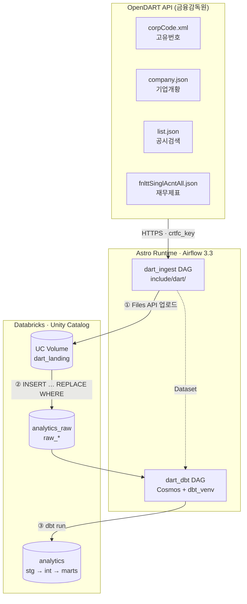

# airflow_dbt — DART 공시 데이터 파이프라인

금융감독원 **[OpenDART](https://opendart.fss.or.kr/)** 공시 API에서 데이터를 수집해 Databricks에 적재하고, **dbt로 분석용 데이터 모델을 구축**하는 프로젝트입니다.

Airflow가 수집(EL)을, dbt가 변환(T)을 담당하며 [Astronomer Cosmos](https://astronomer.github.io/astronomer-cosmos/)가 dbt 모델 1개를 Airflow Task 1개로 자동 변환합니다.

> 설치·설정, 설계 근거, 트러블슈팅은 **[docs/SETUP.md](docs/SETUP.md)** 를 참고하세요.

---

## 아키텍처

<!-- 원본: docs/architecture.mmd -->


| 단계 | 하는 일 | 담당 |
|---|---|---|
| ① 추출 | DART API 호출 → 응답 원본을 JSONL로 Volume에 업로드 | `include/dart/client.py` · `collect.py` · `loader.py` |
| ② 적재 | `INSERT INTO … REPLACE WHERE` 로 Volume 파일(`read_files`)을 실행 날짜(`ds`) 단위로 raw 테이블에 교체 적재 | `include/dart/loader.py` |
| ③ 변환 | raw → staging → intermediate → marts | `include/dbt/dart/` |

**원본 파일을 Volume에 남기는 이유** — 파싱 로직이 바뀌어도 API 재호출 없이 재처리할 수 있습니다. 일일 한도가 있는 API에서 중요한 안전장치입니다.

**적재 규칙: 같은 날짜는 덮어쓰고, 다른 날짜는 이력으로 쌓는다**

| 위치 | 경로 / 기준 | 역할 |
|---|---|---|
| Volume | `dart_landing/<테이블>/<ds>.jsonl` | 응답 원본 그대로 보존 (API 봉투 `status`·`message` 포함). 같은 `ds`로 재실행하면 같은 파일을 덮어씀 |
| raw 테이블 | `REPLACE WHERE _logical_date = DATE '<ds>'` | 필요한 컬럼만 골라 적재. 그 날짜의 행만 통째로 교체. 적재 메타데이터 컬럼 `_logical_date`(스냅샷 날짜) · `_file_path`(원본 파일 경로)를 함께 기록 |

> `COPY INTO` 는 이미 적재한 파일 경로를 다시 읽지 않고(`force` 를 켜면 중복 추가), append 전용이라 "같은 날짜 덮어쓰기" 를 할 수 없어 `REPLACE WHERE` 로 변경했습니다.
>
> 파일 이름의 날짜 · `REPLACE WHERE` 조건 · `_logical_date` 값은 모두 같은 DAG run 의 `ds` 하나에서 나옵니다. 실행 시각(`now()`)을 쓰면 재실행할 때 날짜가 달라져 멱등성이 깨집니다.

**검증 결과 (2026-11-12, `dart_ingest` DAG · 대상 15개사)**

| 실험 | 예상 | 실제 결과 |
|---|---|---|
| ① 같은 날 Trigger 2번 | 오늘치 15건 | `num_inserted_rows` 15건 |
| ② `load_company` 만 Clear 후 재실행 | `num_inserted_rows` 15건 | `num_inserted_rows` 15건 |
| ③ 수집 태스크에서 일부러 에러 (잘못된 `corp_code` 1개) | 전체 태스크 실패, 재시도 1회 | 전체 태스크 실패, 재시도 1회 |
| `WAREHOUSE_ID` 누락 | 재시도 없이 즉시 실패 | `AirflowFailException` 메시지로 즉시 실패 |


## 구현 현황

| # | 단계 | 상태 |
|---|---|---|
| 1 | `requests` 추가 · DAG 경로 환경변수화 | ✅ |
| 2 | Airflow Connection `dart_api` 등록 | ✅ |
| 3 | `include/dart/client.py` — API 클라이언트 | ✅ (재시도는 client에서 _request 최대 3회 처리 — 7~10단계) |
| 4 | `corpCode.xml` 수집 → 대상 종목 목록 확보 | ✅  |
| 4.5 | **[CI 1차]** GitHub Actions — PR마다 단위 테스트(pytest) 자동 실행 | ⬜ |
| 5 | `include/dart/loader.py` — Volume 업로드 + raw 적재 SQL | ✅ (`build_insert_sql` — `INSERT … REPLACE WHERE` + `read_files`. `schema =>` 로 컬럼·타입을 직접 지정해 0건(빈 파일)도 0행으로 적재) |
| 5.5 | **[멱등성 1차]** 같은 날짜로 두 번 적재해도 행 수·내용이 같은지, 다른 날짜는 쌓이는지 확인 | ✅ (같은 날짜 반복 적재 → 15건 유지, 다른 날짜는 따로 쌓임: `_logical_date` 별 15건씩) |
| 6 | Databricks raw 테이블 DDL | ✅ (`raw_company` — 소스 컬럼 17개 + `_logical_date`·`_file_path`. 공시검색·재무제표 테이블은 7~9단계에서) |
| 7~9 | 공시검색 / 기업개황 / 재무제표 수집 태스크 | 🚧 (기업개황: API → Volume → raw 적재 완료 · 공시검색·재무제표 ⬜) |
| 10 | `dags/dart_ingest.py` 조립 + Asset(구 Dataset) 발행 | ✅ (`extract_company` → `load_company` 2태스크 동작. `load_company` 는 SQL·적재 건수 로그, `WAREHOUSE_ID` 없으면 즉시 실패. 성공 시 `outlets` 로 `databricks://<호스트>/workspace/analytics_raw/raw_company` Asset 이벤트 발행 — 호스트는 `.env` 의 `DATABRICKS_HOST_URI`) |
| 10.5 | **[실패 알림]** `on_failure_callback` + Slack 알림, 일부러 실패시켜 수신 확인 (3번과 연관) | ⬜ |
| 10.6 | **[멱등성 2차]** 같은 logical date로 DAG를 두 번 돌려 전후 결과 비교 | ✅ (같은 날 Trigger 2번 · Clear 재실행 후에도 `2026-11-12` 는 15건 그대로) |
| 11~15 | dbt 프로젝트 · staging · marts · 테스트 (실제 DART 데이터 대상) | ⬜ |
| 15.5 | **[증분 모델]** `fct_disclosure` 를 incremental로 전환, late data 처리 기준 정의 | ⬜ |
| 15.6 | **[CI 2차]** GitHub Actions에서 `dbt build` + `dbt test` 실행 (CI 전용 스키마) | ⬜ |
| 16~17 | `dags/dart_dbt.py` + **backfill** (특정 기간 재처리 결과와 full-refresh 결과 비교) | ⬜ |


### dbt 실습 (`include/dbt/chinook/`)

실제 DART dbt 프로젝트(11~15단계)를 시작하기 전, Chinook 샘플 데이터로 staging → intermediate → marts 구조와 테스트 작성을 먼저 연습하는 별도 프로젝트입니다. DART 데이터가 아니므로 위 로드맵과는 무관합니다.

| 단계 | 내용 | 상태 |
|---|---|---|
| 1 | source·staging 모델 | ✅ |
| 2 | intermediate 계층 + `country_region` seed | ✅ |
| 3 | staging·intermediate·seed 테스트 20개 이상 | ✅ |
| 4 | marts 모델 | ✅ (`dim_customer` · `dim_track` · `fct_invoice_line`, #3) |

---

## 수집 범위

| 항목 | 결정 | 근거 |
|---|---|---|
| 적재 방식 | Volume + `INSERT … REPLACE WHERE` | 원본 보존 + 같은 날짜 재실행 시 덮어쓰기(멱등) |
| 대상 종목 | 관심 종목 50~100개 | `target_corps.csv` 로 관리, 확장 용이 |
| 재무제표 기간 | 최근 1년 | 파이프라인 검증 우선 |

이 설정에서 **일일 API 호출은 약 500건 / 20,000건(2.5%)** 입니다.

| 호출 대상 | 건수 |
|---|---|
| `corpCode.xml` | 1 (주 1회면 충분) |
| `company.json` × 100종목 | 100 |
| `list.json` (일자 전체, 페이징 포함) | 5~10 |
| `fnlttSinglAcntAll.json` 100종목 × 4개 보고서 | 400 (분기 단위) |

---

## 모델 매핑

| OpenDART API | raw 테이블 | staging 모델 | 성격 |
|---|---|---|---|
| `corpCode.xml` (고유번호) | `raw_corp_code` | `stg_corp_code` | 전체 스냅샷 |
| `company.json` (기업개황) | `raw_company` | `stg_company` | 스냅샷 |
| `list.json` (공시검색) | `raw_disclosure` | `stg_disclosure` | 일자 증분 |
| `fnlttSinglAcntAll.json` (재무제표) | `raw_fin_stmt` | `stg_fin_stmt` | 연도·보고서 증분 |

```
staging/                        intermediate/                    marts/
  stg_dart__corp_code  ──┐                                        dim_corp
  stg_dart__company    ──┼──▶ int_disclosure_categorized  ──┬──▶  fct_disclosure
  stg_dart__disclosure ──┤                                  │     fct_financial_statement
  stg_dart__fin_stmt   ──┴──▶ int_fin_stmt_pivoted        ──┴──▶  mart_corp_financial_summary
```

> ⚠️ 모든 API가 **8자리 `corp_code`(DART 고유번호)** 를 요구합니다. 6자리 종목코드로는 조회되지 않으므로, `corpCode.xml` 수집이 다른 모든 수집의 선행 조건입니다.

---

## 프로젝트 구조

```
airflow_dbt/
├── Dockerfile                      # Astro Runtime 이미지 + dbt 전용 venv
├── requirements.txt                # Docker 이미지용 — Cosmos, Databricks provider, requests
├── requirements-dev.txt            # 로컬 .venv 용 — pytest 등 테스트에 필요한 것만 (Airflow 제외)
├── .env                            # Connection 정의 (Git 제외)
│
├── docs/
│   ├── architecture.mmd            # 아키텍처 다이어그램 원본
│   ├── SETUP.md                    # 설정 · 설계 노트 · 트러블슈팅
│   └── blog/                       # 블로그 소재 메모 (Git 제외)
│
├── dags/
│   ├── check_databricks_conn.py    # Databricks Connection 확인용
│   ├── dart_ingest.py              # DART 수집 DAG (기업개황: 수집 → Volume → raw 적재)
│   └── dart_dbt.py                 # 예정 — Cosmos DbtDag
│
├── include/
│   ├── dart/                       # ★ Python 수집 로직
│   │   ├── client.py               # OpenDART API 클라이언트 (재시도 포함)
│   │   ├── corp_code.py            # corpCode.xml 파싱 → 대상 종목 CSV
│   │   ├── collect.py              # 무엇을 수집할지 (기업개황 → 공시검색·재무제표 예정)
│   │   ├── loader.py               # JSONL 변환 · Volume 업로드 · SQL 실행
│   │   ├── sql/raw_company.sql     # raw 테이블 DDL
│   │   └── endpoints.py            # 예정 — 엔드포인트별 파라미터 정의
│   │
│   └── dbt/                        # ★ dbt 프로젝트 전용 (Python 파일 금지)
│       ├── chinook/                # dbt 실습용 (Chinook 샘플 데이터, DART 아님)
│       │   ├── dbt_project.yml
│       │   ├── seeds/country_region.csv
│       │   └── models/
│       │       ├── staging/
│       │       ├── intermediate/
│       │       └── marts/
│       └── dart/                   # 실제 DART dbt 프로젝트 (dbt init 상태, 11~15단계에서 구현)
│           ├── dbt_project.yml
│           ├── seeds/target_corps.csv   # 대상 종목 목록 (수집·dbt 공용)
│           └── models/
│               ├── staging/
│               ├── intermediate/
│               └── marts/
│
├── data/                           # Git 제외 · 이미지 빌드 때 컨테이너로 복사
│   ├── roles.csv                   # 관심 종목 corp_code + role (사람이 관리)
│   └── target_corps.csv            # corp_code.py 가 생성하는 대상 종목 (현재 수집이 읽는 파일)
│
└── tests/
    ├── dags/                       # DAG 무결성 테스트
    └── dart/                       # 수집 로직 단위 테스트 (*_integ* 는 실데이터 통합 테스트)
```

> **`include/dart/` 와 `include/dbt/dart/` 를 혼동하지 마세요.** 앞은 Python 수집 코드, 뒤는 dbt 프로젝트입니다. `include/dbt/` 아래에 Python 파일을 두면 dbt 실행 시 뒤섞입니다.
>
> **`include/dbt/dart/` 는 `dbt init` 직후 상태입니다** (예제 모델만 있음). 실제 DART 모델은 11~15단계에서 작성합니다.

**`target_corps.csv` 가 단일 소스** — 수집 로직과 dbt seed가 같은 파일을 참조하므로, 종목 추가/제거가 이 파일 수정 한 번으로 끝납니다.

> 현재는 `data/target_corps.csv` 에 있고, 컨테이너 안에서는 `$AIRFLOW_HOME/data/target_corps.csv` 로 읽습니다. `data/` 는 마운트가 아니라 이미지 빌드 때 복사되므로 **목록을 바꾸면 `astro dev restart` 가 필요**하고, Git 제외 대상이라 CI·배포 환경에는 없습니다. 11단계에서 `include/dbt/dart/seeds/` 로 옮겨 이 문제를 함께 정리합니다.
